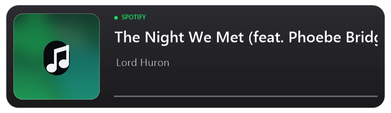

# Spotify Overlay for OBS

A small native OBS Studio plugin that shows what is currently playing in Spotify: cover art, track title, artist and a smooth progress bar. Long titles scroll instead of being cut off.

**English** | [Polski](README.pl.md)

## Features

- Cover art, title, artist and progress bar read from the Spotify desktop app
- Smooth marquee scrolling for titles that do not fit
- Dark, light and color themes
- Background transparency that keeps the text and cover opaque
- Theme brightness slider that works with every theme
- Separate title and artist font sizes with independent bold toggles
- Optional panel background and optional "SPOTIFY" label
- Option to crop the Spotify logo that is baked into some cover images
- Progress bar with adjustable thickness, width and color
- Progress follows playback, including seeks and pauses
- No login, no API keys, no browser source, no helper process, no network access

## Requirements

| | |
| --- | --- |
| System | Windows 10 or Windows 11 (64-bit) |
| OBS Studio | 33.x |
| Player | Spotify desktop app (the web player is not supported) |

## Installation

1. Download `SpotifyOverlay-OBS.zip` from the [latest release](../../releases/latest).
2. Close OBS Studio.
3. Unpack the ZIP and run `Install.bat`. Confirm the administrator prompt.
4. Start OBS Studio.
5. In the **Sources** panel click `+` and select **Spotify - Now Playing**.
6. Play a track in Spotify.

The plugin is copied to `C:\ProgramData\obs-studio\plugins\spotify-overlay`. No other setup is needed.

The installer also removes the "downloaded from the internet" mark from the copied files and tells you if Smart App Control is turned on.

### Installation without running a script

Windows can warn about `Install.bat` because it came from the internet. If you prefer not to run it, install manually:

1. Unpack the ZIP.
2. Open `C:\ProgramData\obs-studio\plugins` in File Explorer (paste the path into the address bar).
3. Create a folder named `spotify-overlay`.
4. Copy `spotify-overlay.dll` and the whole `data` folder into it.
5. Right-click the copied DLL, open **Properties** and tick **Unblock** if that option is shown.
6. Start OBS Studio.

Creating folders in `ProgramData` needs administrator rights, so Windows may ask for confirmation.

## Using it

- The source updates itself when the track, artist or cover changes.
- You can move and scale it like any other OBS source.
- The default size is 760 × 220 px. With very large text the source grows taller so nothing overlaps; adjust its scale in OBS after changing the font size.
- To hide the panel and show only the text and cover, turn off **Show background** and place the source over your own overlay.

## Settings

Double-click the source to open its properties.

| Setting | Description |
| --- | --- |
| Theme | Dark, Light or Color. Color adds a theme hue slider. |
| Theme hue | 0-360°. Shown only with the Color theme. |
| Theme brightness | -100% to 40%. Lightens or darkens the theme. Text switches between light and dark so it stays readable. |
| Background transparency | 0-100%. 0 keeps the panel, 100 makes it fully transparent. Text and cover stay opaque. |
| Title size | 18-96 px. Default: 30. |
| Artist size | 12-64 px. Default: 20. |
| Bold title | Semibold title font. On by default. |
| Bold artist | Semibold artist font. Off by default. |
| Title scroll speed | 0–120 px/s. Default: 35. At 0 the title does not scroll and ends with an ellipsis. |
| Show background | Panel background behind the text. |
| Show SPOTIFY text | The small "SPOTIFY" label and its dot. |
| Hide Spotify text and logo under the cover | Crops the bottom of the artwork to remove the Spotify mark. It may slightly crop the image itself. |
| Show progress bar | Turns the progress bar on or off. |
| Progress bar thickness | 2–12 px. Default: 3. |
| Progress bar width | 50–100%. Default: 100. The bar never extends past the right edge of the panel. |
| Progress bar color (hue) | 0–360°. 142 is Spotify green. |
| Preview mode | Shows a sample track without Spotify running. |

With very large title or artist sizes the source grows taller automatically, so the text and the progress bar never overlap. After changing the size, adjust the source scale in OBS if needed.

## Smart App Control (Windows 11)

Smart App Control is a Windows 11 feature that blocks every DLL that is not signed by a certificate from a vendor in the Microsoft Trusted Root Program. This plugin is not code-signed, so on a PC with Smart App Control turned **On**, OBS cannot load it. Windows shows a message such as "Smart App Control blocked an app that may be unsafe".

How to check: **Settings > Privacy & security > Windows Security > App & browser control > Smart App Control settings**.

- **Off** – the plugin works.
- **On** – the plugin is blocked. Smart App Control has no allow list and no per-app exception.
- **Evaluation** – Smart App Control only observes what runs, so the plugin should work.

If it is **On**, you have two options:

1. Turn Smart App Control off. Windows 11 24H2 (build 26100.8116) and newer let you turn it back on later; on older builds it can only be re-enabled by resetting Windows.
2. Use a build signed by a certificate authority in the Microsoft Trusted Root Program. There is no signed build yet.

Unblocking the ZIP, adding an antivirus exclusion or turning off SmartScreen does not help. Only a trusted signature or turning Smart App Control off does.

## Troubleshooting

| Problem | Fix |
| --- | --- |
| "Nothing is playing" | Start the Spotify desktop app and play a track. |
| No cover image | Spotify sometimes does not share artwork. A music-note placeholder is shown instead. |
| The plugin is not in the source list | Make sure you have 64-bit OBS Studio 33.x and that OBS was closed during installation. |
| Antivirus warning | The DLL is not code-signed. The plugin only reads the local Windows media session and never connects to the internet. |
| "Smart App Control blocked an app that may be unsafe" | See [Smart App Control](#smart-app-control-windows-11). The plugin is unsigned, so Smart App Control must be off or the build must be signed by a trusted CA. |
| The old track stays for a moment | Windows exposes media state with a short delay, usually under a second. |

## Uninstall

Close OBS Studio and run `Uninstall.bat` from the extracted folder. Your OBS scenes are not touched.

## Privacy

The plugin reads the current media session through the Windows System Media Transport Controls API. Everything happens locally on your computer. It does not connect to the internet, does not use a Spotify account, does not read files outside its own folder and does not collect, store or send any data.

## Compatibility

Built and tested against OBS Studio 33.0.1 on Windows 10/11 x64. OBS 34 and newer may require a rebuild; OBS 32 and older will not load this build.

## Disclaimer

Not affiliated with Spotify AB or the OBS Project. Spotify is a trademark of Spotify AB.
