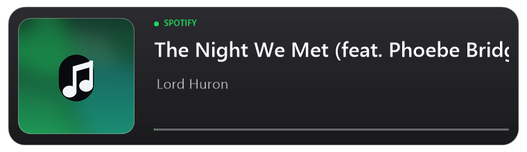

# Spotify Overlay dla OBS

Mała, natywna wtyczka do OBS Studio, która pokazuje, co aktualnie leci w Spotify: okładkę, tytuł, wykonawcę i płynny pasek postępu. Długie tytuły się przewijają, zamiast być ucinane.

[English](README.md) | **Polski**

## Funkcje

- okładka, tytuł, wykonawca i pasek postępu pobierane z aplikacji Spotify,
- płynne przewijanie tytułów, które się nie mieszczą,
- motyw ciemny i jasny,
- osobne rozmiary tytułu i wykonawcy oraz osobne pogrubienie,
- opcjonalne tło panelu i opcjonalny napis „SPOTIFY”,
- opcja przycięcia logo Spotify, które jest wtopione w niektóre okładki,
- pasek postępu z regulacją grubości, szerokości i koloru,
- pasek reaguje na odtwarzanie, pauzę i przewijanie utworu,
- bez logowania, kluczy API, źródła przeglądarkowego, dodatkowych procesów i bez dostępu do internetu.

## Wymagania

| | |
| --- | --- |
| System | Windows 10 lub Windows 11 (64-bit) |
| OBS Studio | 33.x |
| Odtwarzacz | aplikacja Spotify dla Windows (wersja w przeglądarce nie jest obsługiwana) |

## Instalacja

1. Pobierz `SpotifyOverlay-OBS.zip` z [najnowszego wydania](../../releases/latest).
2. Zamknij OBS Studio.
3. Rozpakuj archiwum i uruchom `Install.bat`. Potwierdź prośbę o uprawnienia administratora.
4. Uruchom OBS Studio.
5. W panelu **Źródła** kliknij `+` i wybierz **Spotify - Teraz odtwarzane**.
6. Włącz utwór w Spotify.

Wtyczka trafia do `C:\ProgramData\obs-studio\plugins\spotify-overlay`. Nic więcej nie trzeba konfigurować.

## Używanie

- Źródło samo aktualizuje się, gdy zmieni się utwór, wykonawca lub okładka.
- Możesz je przesuwać i skalować jak każde inne źródło w OBS.
- Domyślny rozmiar to 760 × 220 px. Przy zmianie rozmiaru zachowaj proporcje.
- Aby ukryć panel i pokazać tylko tekst i okładkę, wyłącz **Pokaż tło** i połóż źródło na własnym overlayu.

## Ustawienia

Kliknij dwukrotnie źródło, aby otworzyć ustawienia.

| Ustawienie | Opis |
| --- | --- |
| Motyw | Ciemny lub jasny panel. |
| Wielkość tytułu | 18–44 px. Domyślnie 30. |
| Wielkość wykonawcy | 12–30 px. Domyślnie 20. |
| Pogrub tytuł | Pogrubiona czcionka tytułu. Domyślnie włączone. |
| Pogrub wykonawcę | Pogrubiona czcionka wykonawcy. Domyślnie wyłączone. |
| Prędkość przewijania tytułu | 0–120 px/s. Domyślnie 35. Przy 0 tytuł się nie przewija i kończy się wielokropkiem. |
| Pokaż tło | Tło panelu za tekstem. |
| Pokaż napis SPOTIFY | Mały napis „SPOTIFY” i zielona kropka. |
| Ukryj napis i logo Spotify pod okładką | Przycina dół okładki, żeby usunąć znak Spotify. Może lekko przyciąć samą grafikę. |
| Pokaż pasek postępu | Włącza lub wyłącza pasek. |
| Grubość paska postępu | 2–12 px. Domyślnie 3. |
| Szerokość paska postępu | 50–100%. Domyślnie 100. Pasek nigdy nie wychodzi poza prawą krawędź panelu. |
| Kolor paska postępu (odcień) | 0–360°. 142 to zielony Spotify. |
| Tryb podglądu | Pokazuje przykładowy utwór bez uruchomionego Spotify. |

## Jeśli coś nie działa

| Problem | Rozwiązanie |
| --- | --- |
| „Nic nie jest odtwarzane” | Uruchom aplikację Spotify i włącz utwór. |
| Brak okładki | Spotify czasem nie udostępnia grafiki. Wtedy pojawia się miejsce z nutką. |
| Wtyczki nie ma na liście źródeł | Upewnij się, że masz 64-bitowy OBS Studio 33.x i że OBS był zamknięty podczas instalacji. |
| Ostrzeżenie antywirusa | Plik nie jest podpisany cyfrowo. Wtyczka czyta tylko lokalną sesję multimedialną Windows i nie łączy się z internetem. |
| Stary utwór zostaje na chwilę | Windows udostępnia stan multimediów z krótkim opóźnieniem, zwykle poniżej sekundy. |

## Odinstalowanie

Zamknij OBS Studio i uruchom `Uninstall.bat` z rozpakowanego folderu. Sceny w OBS nie zostaną zmienione.

## Prywatność

Wtyczka odczytuje bieżącą sesję multimedialną przez Windows System Media Transport Controls. Wszystko dzieje się lokalnie. Wtyczka nie łączy się z internetem, nie używa konta Spotify, nie czyta plików spoza swojego folderu i nie zbiera, nie zapisuje ani nie wysyła żadnych danych.

## Zgodność

Zbudowana i przetestowana z OBS Studio 33.0.1 na Windows 10/11 x64. OBS 34 i nowsze mogą wymagać przebudowania; OBS 32 i starsze nie wczytają tej wersji.

## Zastrzeżenia

Projekt nie jest powiązany z Spotify AB ani z projektem OBS. Spotify jest znakiem towarowym Spotify AB.
